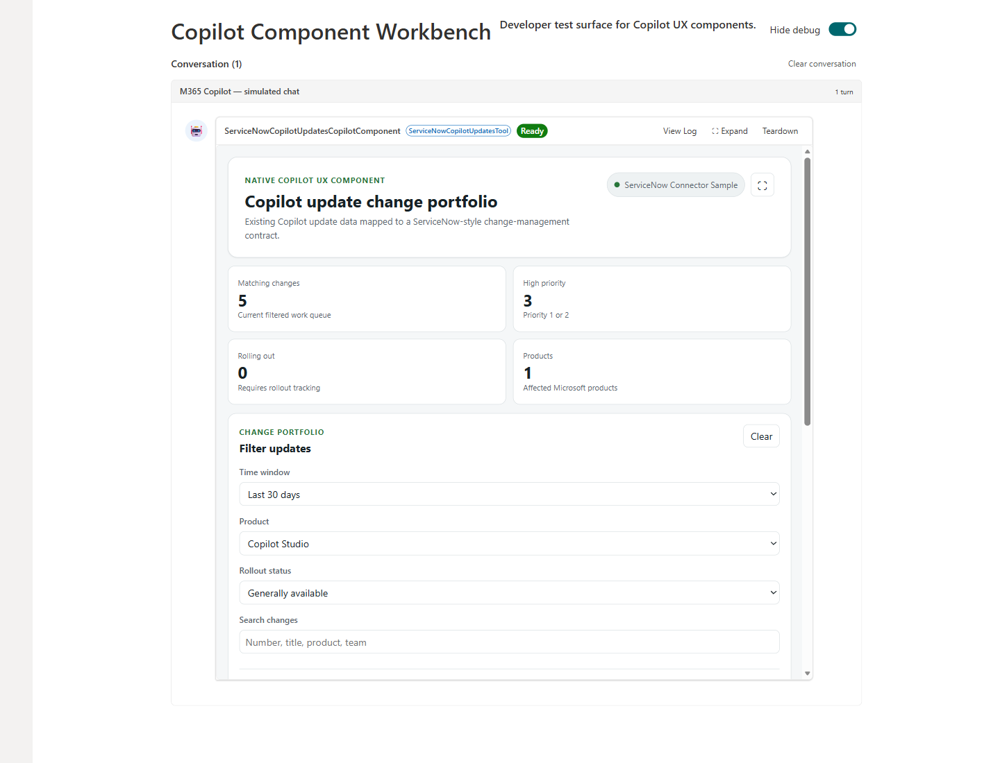
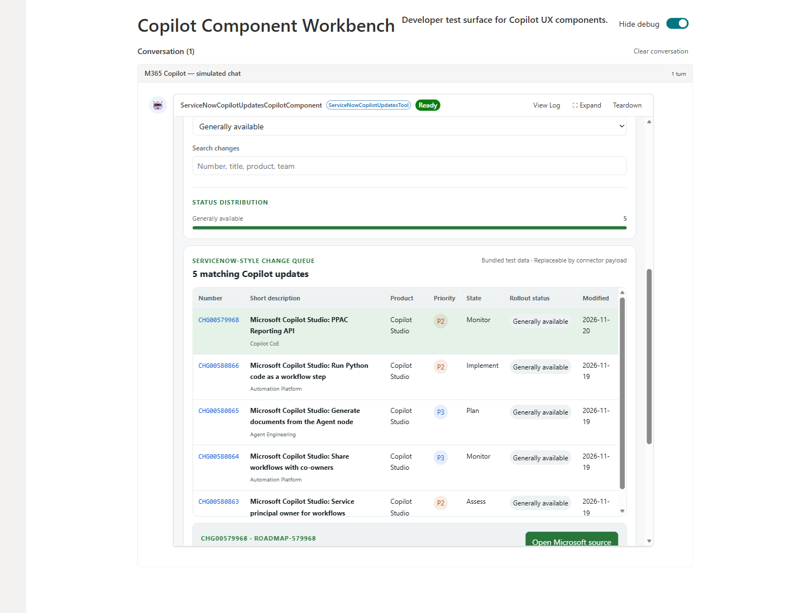
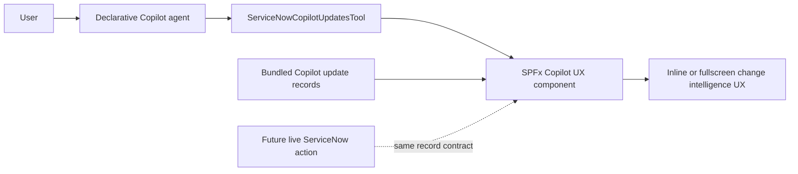

# ServiceNow Copilot Change Intelligence

Native Microsoft 365 Copilot UX component built with **SharePoint Framework 1.24.1**. It presents existing Microsoft Copilot update data as a ServiceNow-style change portfolio with metrics, filters, work-queue records, details, and inline/fullscreen display modes.

This implementation follows Microsoft’s native [Copilot UX component](https://learn.microsoft.com/sharepoint/dev/spfx/copilot/get-started/build-your-first-copilot-app) model. It does **not** require an MCP server, Azure Container Apps, or an API key.

<p align="center">
  
</p>
<p align="center"><sub>Native SPFx Copilot UX running in the tenant Copilot Workbench with filtered Copilot Studio change records.</sub></p>

### Agent screenshots

| Change portfolio | Selected change details | Fullscreen experience |
|---|---|---|
|  |  |  |

These tenant test captures show portfolio filtering, record drill-down, and inline or fullscreen rendering with the same native component.

## What this sample demonstrates

- SPFx `CopilotComponent` with `copilotType: "Ux"`
- Declarative Microsoft 365 Copilot agent
- Zod tool-properties schema
- ServiceNow-style connector contract
- Existing Copilot Roadmap data mapped into change records
- Inline and fullscreen rendering
- Time-window, product, rollout-status, and search filters
- Change portfolio KPIs and status distribution
- Keyboard-accessible work-queue row selection
- Detailed source, ownership, priority, status, and description view
- Bundled sample data for immediate Workbench testing
- Optional `records` property for future live connector results

## Architecture



The sample intentionally separates the **UX component** from the **data provider**:

1. The declarative agent recognizes a change-intelligence request.
2. It invokes `ServiceNowCopilotUpdatesTool`.
3. The tool passes filters and optional connector records into the component.
4. The SPFx component renders the native Copilot UX.
5. When `records` is absent, bundled Copilot update data is used for testing.

See [the connector contract](./docs/connector-contract.md) for field mapping.

## Prerequisites

- Microsoft 365 tenant with a SharePoint app catalog
- Microsoft 365 Copilot license
- Permission to upload and deploy `.sppkg` solutions
- SPFx 1.24.1 compatible Node.js:
  - Node 22.14 or later in the 22.x line
  - Node 24
  - Node 26
- npm
- Visual Studio Code or another editor

Verify:

```powershell
node --version
npm --version
```

## Install

```powershell
git clone https://github.com/ukpkumar/Copilot-UX-ServiceNow-Connector-Sample-Agent.git
Set-Location .\Copilot-UX-ServiceNow-Connector-Sample-Agent
npm install
```

## Test in Copilot Workbench

### 1. Start the local development server

```powershell
npm run start -- --nobrowser
```

The debug manifests are served from:

```text
https://localhost:4321
```

### 2. Open Copilot Workbench

Replace the tenant name and open the Workbench with the local debug manifest:

```text
https://<tenant>.sharepoint.com/_layouts/15/copilotworkbench.aspx?debugManifestsFile=https%3A%2F%2Flocalhost%3A4321%2Ftemp%2Fbuild%2Fmanifests.js
```

1. Select **Load debug scripts**.
2. If the browser asks whether SharePoint can access apps and services on this device, select **Allow**. This permits the Workbench to reach the localhost development server.

### 3. Activate the component

1. Select **ServiceNowCopilotUpdates** from the component list.
2. Paste the properties from [`samples/workbench-properties.json`](./samples/workbench-properties.json).
3. Select **Fire turn**.

Example:

```json
{
  "title": "Copilot update change portfolio",
  "timeWindowDays": 30,
  "product": "Copilot Studio",
  "status": "Generally available",
  "connectorName": "ServiceNow Connector Sample"
}
```

### 4. Validate the experience

Confirm:

- metric cards contain nonzero values;
- product, status, time-window, and search filters work;
- selecting a work-queue row opens the change details;
- source, Roadmap ID, priority, state, assignment, and modified date appear;
- the Microsoft source link uses HTTP/HTTPS;
- fullscreen mode opens from the header;
- keyboard users can select rows with Enter or Space;
- light and dark host themes remain readable.

## Agent prompts

After deployment, try:

```text
Show the Copilot update change portfolio for the last 30 days.
```

```text
Show Copilot Studio changes and highlight high-priority items.
```

```text
Show changes that are rolling out or still in development.
```

The declarative-agent instructions tell Copilot to pass period, product, and rollout status to the native UX tool.

## ServiceNow-style data contract

The component accepts:

```typescript
{
  title?: string;
  timeWindowDays?: number;
  product?: string;
  status?: string;
  connectorName?: string;
  records?: ServiceNowUpdateRecord[];
}
```

Each record contains:

```typescript
{
  sysId: string;
  number: string;
  shortDescription: string;
  description: string;
  product: string;
  source: string;
  status: "In development" | "Rolling out" | "Generally available" | "Unknown";
  priority: "1" | "2" | "3" | "4" | "5";
  state: "Assess" | "Plan" | "Implement" | "Monitor" | "Closed";
  assignedTo: string;
  modifiedOn: string;
  sourceUrl?: string;
  roadmapId?: string;
}
```

The bundled dataset contains real Copilot update examples mapped to this contract. It is not presented as data retrieved from a live ServiceNow tenant.

Validate the sample contract:

```powershell
npm run validate:sample
```

## Connect live ServiceNow data later

To replace bundled data:

1. Create a ServiceNow connector, API plugin, or secured intermediary API.
2. Retrieve the desired change/update records.
3. Map the response to the documented record contract.
4. Pass the resulting array to the component’s `records` property.
5. Keep authentication and secrets in the connector or API layer—not in component properties.

The component requires no redesign when the provider changes because the record contract remains stable.

## Production package

Build and package:

```powershell
npm run build
```

The package is created under:

```text
sharepoint/solution/service-now-copilot-updates-ux.sppkg
```

## Deploy as a Microsoft 365 Copilot agent

Download the ready-to-deploy package from the
[v0.1.0 release](https://github.com/ukpkumar/Copilot-UX-ServiceNow-Connector-Sample-Agent/releases/tag/v0.1.0),
or build it locally using the command above.

### 1. Deploy through the SharePoint app catalog

1. Open the tenant SharePoint app catalog.
2. Open **Apps for SharePoint**.
3. Upload `service-now-copilot-updates-ux.sppkg`.
4. Keep **Enable this app and add it to all sites** selected.
5. Select **Enable app**.
6. Select the uploaded application.
7. Select **Add to Teams**.

**Add to Teams** synchronizes the declarative agent and its native Copilot UX component to the tenant app catalog. If the tenant does not have an app catalog yet, a SharePoint administrator must create it before uploading the package.

### 2. Add the agent in Microsoft 365 Copilot

After tenant propagation:

1. Open [Microsoft 365 Copilot](https://m365.cloud.microsoft/chat).
2. Open **Agents**, then **Get agents** or **All agents**.
3. Search for **ServiceNow Copilot Change Intelligence**.
4. Select **Add**, then open the agent.
5. Try one of the prompts in the [Agent prompts](#agent-prompts) section.

The first tool invocation may request permission. Select **Allow** so the agent can render `ServiceNowCopilotUpdatesTool`.

### Verified deployment

The packaged sample was deployed successfully to a Microsoft 365 test tenant on November 23, 2026:

- SharePoint accepted the package as a valid custom app.
- The solution was enabled tenant-wide and added to all sites.
- **Add to Teams** completed successfully, publishing the declarative agent package.
- The app catalog reported version `1.0.0.0` as **Enabled**.

<p align="center">
  
</p>
<p align="center"><sub>The deployed package is enabled, valid, available to SharePoint and Teams, and added to all sites.</sub></p>

Tenant agent-catalog propagation is asynchronous and can take several minutes after **Add to Teams** completes.

## Does this work with Copilot Studio?

**Not directly.** This repository implements a native SPFx Copilot UX component for a Microsoft 365 Copilot declarative agent. Copilot Studio cannot import the `.sppkg`, host `BaseCopilotComponent`, or invoke this Copilot Component manifest as a native Copilot Studio agent UI.

The same scenario can still be implemented in Copilot Studio by retaining the data and experience design while replacing the rendering and deployment layers:

| This native Microsoft 365 Copilot sample | Copilot Studio equivalent |
|---|---|
| SPFx `BaseCopilotComponent` | MCP App embedded UI |
| Copilot Component tool manifest | MCP server tool and UI resource |
| SharePoint `.sppkg` | Hosted MCP server |
| SharePoint App Catalog and **Add to Teams** | Copilot Studio MCP connection and agent publishing |
| Native inline/fullscreen component | Embedded MCP App, Adaptive Card, or linked Power App |

### What can be reused

- ServiceNow-style record contract and field mapping
- Copilot update sample data
- KPI, filter, search, work-queue, and detail-view behavior
- Agent prompts and change-intelligence instructions
- Live ServiceNow connector or secured API response shape

### What must be rebuilt

- The SPFx rendering class and component manifest
- The `.sppkg` packaging and SharePoint deployment flow
- Host-specific inline/fullscreen integration

For the closest Copilot Studio experience, use the
[Copilot UX Powered by MCP Apps in Copilot Studio](https://github.com/ukpkumar/Copilot-UX-Powered-by-MCP-Apps-in-Copilot-Studio)
implementation pattern. Adaptive Cards are a simpler native alternative but provide less dashboard interactivity; Power Apps can provide a rich interface but generally opens as a separate application experience.

## Important distinction

This is a **native SPFx Copilot UX component**:

| Native Copilot UX | MCP Apps implementation |
|---|---|
| `BaseCopilotComponent` | MCP server |
| SPFx component manifest | MCP tool metadata |
| `render()` into host DOM | `ui://` HTML resource |
| Copilot Workbench | MCP Apps host harness |
| SharePoint `.sppkg` | Container deployment |
| SharePoint app catalog | Azure Container Apps |
| Microsoft 365 identity | API-key/OAuth MCP connection |

## Project structure

```text
copilot/
  declarativeAgent.json
  ai-plugin.json
  instruction.txt
config/
  copilot-agent.json
docs/
  connector-contract.md
samples/
  workbench-properties.json
src/
  data/
    copilotUpdates.sample.json
  copilotComponents/
    serviceNowCopilotUpdates/
      ServiceNowCopilotUpdatesCopilotComponent.ts
      ServiceNowCopilotUpdatesCopilotComponentProperties.ts
      ServiceNowCopilotUpdatesCopilotComponent.manifest.json
      ServiceNowCopilotUpdatesCopilotComponent.module.scss
```

## References

- [Build your first Copilot UX component](https://learn.microsoft.com/sharepoint/dev/spfx/copilot/get-started/build-your-first-copilot-app)
- [Overview of Copilot UX components](https://learn.microsoft.com/sharepoint/dev/spfx/copilot/overview-copilot-apps)
- [SPFx compatibility reference](https://learn.microsoft.com/sharepoint/dev/spfx/compatibility)
