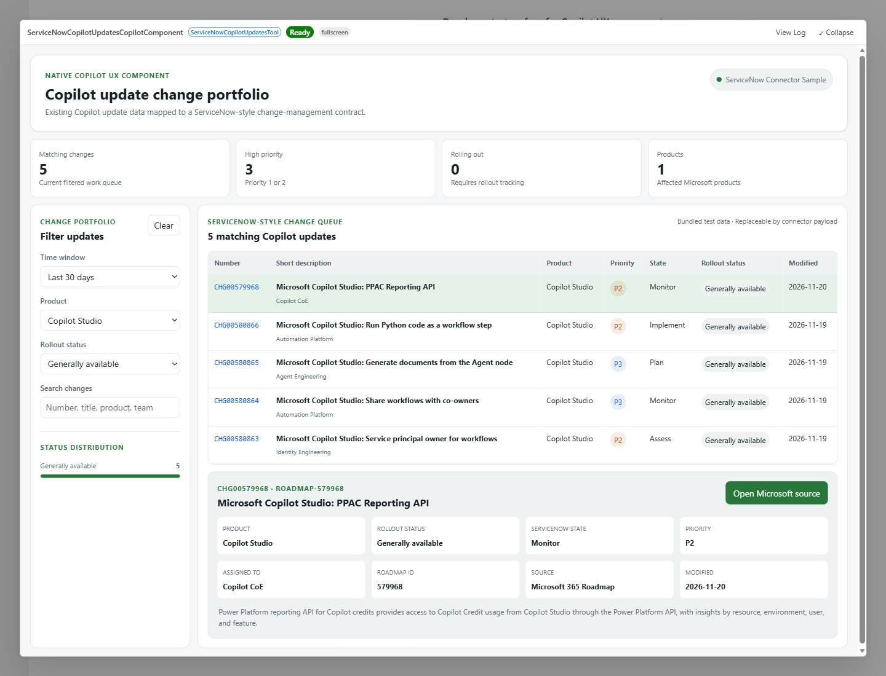
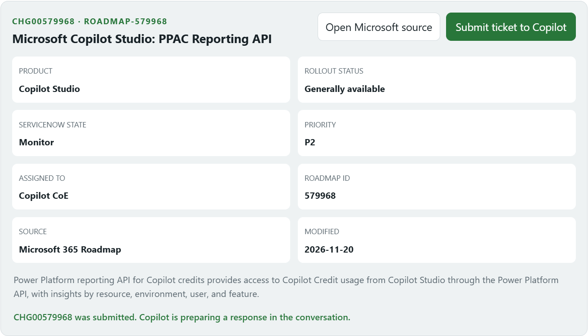
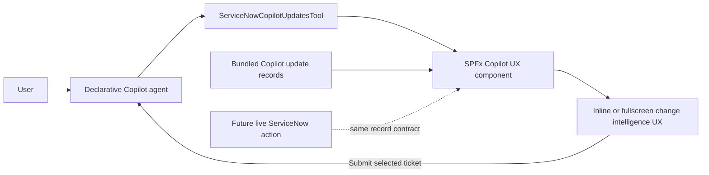
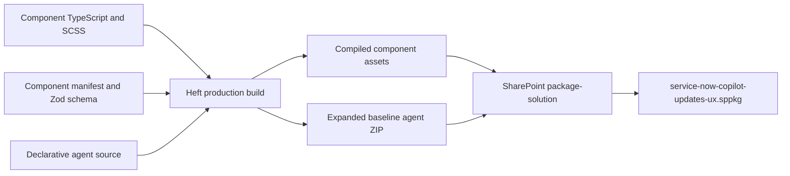

# ServiceNow Copilot Change Intelligence

Native Microsoft 365 Copilot UX component built with **SharePoint Framework 1.24.1**. It presents existing Microsoft Copilot update data as a ServiceNow-style change portfolio with metrics, filters, work-queue records, details, and inline/fullscreen display modes.

This implementation follows Microsoft’s native [Copilot UX component](https://learn.microsoft.com/sharepoint/dev/spfx/copilot/get-started/build-your-first-copilot-app) model. It does **not** require an MCP server, Azure Container Apps, or an API key.

<p align="center">
  
</p>
<p align="center"><sub>Native SPFx Copilot UX running in the tenant Copilot Workbench with filtered Copilot Studio change records.</sub></p>

### Agent screenshots

| Change portfolio | Selected change details | Fullscreen experience |
|---|---|---|
|  |  |  |

These tenant test captures show portfolio filtering, record drill-down, and inline or fullscreen rendering with the same native component.

<p align="center">
  
</p>
<p align="center"><sub>Selecting a ticket and choosing <strong>Submit ticket to Copilot</strong> publishes the record as model context and starts a ticket-specific follow-up.</sub></p>

## What this sample demonstrates

- SPFx `CopilotComponent` with `copilotType: "Ux"`
- Declarative Microsoft 365 Copilot agent
- Zod tool-properties schema
- ServiceNow-style connector contract
- Existing Copilot Roadmap data mapped into change records
- Inline and fullscreen rendering
- Time-window, product, rollout-status, and search filters
- Change portfolio KPIs and status distribution
- Keyboard-accessible work-queue row selection
- Detailed source, ownership, priority, status, and description view
- Selected-ticket submission back to the Copilot conversation
- Model context for ticket-specific explanations and recommended next steps
- Bundled sample data for immediate Workbench testing
- Optional `records` property for future live connector results

## Architecture



The sample intentionally separates the **UX component** from the **data provider**:

1. The declarative agent recognizes a change-intelligence request.
2. It invokes `ServiceNowCopilotUpdatesTool`.
3. The tool passes filters and optional connector records into the component.
4. The SPFx component renders the native Copilot UX.
5. When `records` is absent, bundled Copilot update data is used for testing.

See [the connector contract](./docs/connector-contract.md) for field mapping.

## Prerequisites

- Microsoft 365 tenant with a SharePoint app catalog
- Microsoft 365 Copilot license
- Permission to upload and deploy `.sppkg` solutions
- SPFx 1.24.1 compatible Node.js:
  - Node 22.14 or later in the 22.x line
  - Node 24
  - Node 26
- npm
- Visual Studio Code or another editor

Verify:

```powershell
node --version
npm --version
```

## Install

```powershell
git clone https://github.com/ukpkumar/Copilot-UX-ServiceNow-Connector-Sample-Agent.git
Set-Location .\Copilot-UX-ServiceNow-Connector-Sample-Agent
npm install
```

## Test in Copilot Workbench

### 1. Start the local development server

```powershell
npm run start -- --nobrowser
```

The debug manifests are served from:

```text
https://localhost:4321
```

### 2. Open Copilot Workbench

Replace the tenant name and open the Workbench with the local debug manifest:

```text
https://<tenant>.sharepoint.com/_layouts/15/copilotworkbench.aspx?debugManifestsFile=https%3A%2F%2Flocalhost%3A4321%2Ftemp%2Fbuild%2Fmanifests.js
```

1. Select **Load debug scripts**.
2. If the browser asks whether SharePoint can access apps and services on this device, select **Allow**. This permits the Workbench to reach the localhost development server.

### 3. Activate the component

1. Select **ServiceNowCopilotUpdates** from the component list.
2. Paste the properties from [`samples/workbench-properties.json`](./samples/workbench-properties.json).
3. Select **Fire turn**.

Example:

```json
{
  "title": "Copilot update change portfolio",
  "timeWindowDays": 30,
  "product": "Copilot Studio",
  "status": "Generally available",
  "connectorName": "ServiceNow Connector Sample"
}
```

### 4. Validate the experience

Confirm:

- metric cards contain nonzero values;
- product, status, time-window, and search filters work;
- selecting a work-queue row opens the change details;
- **Submit ticket to Copilot** sends the selected record into the conversation;
- Copilot responds with the selected ticket number, facts, potential impact, and next steps;
- source, Roadmap ID, priority, state, assignment, and modified date appear;
- the Microsoft source link uses HTTP/HTTPS;
- fullscreen mode opens from the header;
- keyboard users can select rows with Enter or Space;
- light and dark host themes remain readable.

## Agent prompts

After deployment, try:

```text
Show the Copilot update change portfolio for the last 30 days.
```

```text
Show Copilot Studio changes and highlight high-priority items.
```

```text
Show changes that are rolling out or still in development.
```

The declarative-agent instructions tell Copilot to pass period, product, and rollout status to the native UX tool.

To ask about a specific ticket, select its work-queue row and choose **Submit ticket to Copilot**. The component publishes the selected record as model context and sends a user-triggered follow-up message. Copilot then explains that ticket in the existing conversation without requiring the user to copy its number or description manually.

## ServiceNow-style data contract

The component accepts:

```typescript
{
  title?: string;
  timeWindowDays?: number;
  product?: string;
  status?: string;
  connectorName?: string;
  records?: ServiceNowUpdateRecord[];
}
```

Each record contains:

```typescript
{
  sysId: string;
  number: string;
  shortDescription: string;
  description: string;
  product: string;
  source: string;
  status: "In development" | "Rolling out" | "Generally available" | "Unknown";
  priority: "1" | "2" | "3" | "4" | "5";
  state: "Assess" | "Plan" | "Implement" | "Monitor" | "Closed";
  assignedTo: string;
  modifiedOn: string;
  sourceUrl?: string;
  roadmapId?: string;
}
```

The bundled dataset contains real Copilot update examples mapped to this contract. It is not presented as data retrieved from a live ServiceNow tenant.

Validate the sample contract:

```powershell
npm run validate:sample
```

## Connect live ServiceNow data later

To replace bundled data:

1. Create a ServiceNow connector, API plugin, or secured intermediary API.
2. Retrieve the desired change/update records.
3. Map the response to the documented record contract.
4. Pass the resulting array to the component’s `records` property.
5. Keep authentication and secrets in the connector or API layer—not in component properties.

The component requires no redesign when the provider changes because the record contract remains stable.

## Build from code: Copilot UX component, declarative agent, and SharePoint package

This section follows the same code-first model as Microsoft’s
[Build your first Copilot UX component](https://learn.microsoft.com/sharepoint/dev/spfx/copilot/get-started/build-your-first-copilot-app)
tutorial. It explains how the source becomes both a declarative agent and a deployable SharePoint `.sppkg`.

### Path A: clone and build this completed sample

```powershell
git clone https://github.com/ukpkumar/Copilot-UX-ServiceNow-Connector-Sample-Agent.git
Set-Location .\Copilot-UX-ServiceNow-Connector-Sample-Agent
npm install
npm run validate:sample
npm run build
```

The finished package is written to:

```text
sharepoint/solution/service-now-copilot-updates-ux.sppkg
```

Use the following steps to understand or recreate the implementation.

### Path B: scaffold a new Copilot Component project

Create a folder and run the SPFx generator:

```powershell
New-Item -ItemType Directory service-now-copilot-updates-ux
Set-Location .\service-now-copilot-updates-ux
yo @microsoft/sharepoint
```

Choose:

| Generator prompt | Value |
|---|---|
| Solution name | `service-now-copilot-updates-ux` |
| Client-side component type | **Copilot Component** |
| Component name | `ServiceNowCopilotUpdates` |
| Template | **No framework** |

The generator creates the SPFx build configuration, `src/copilotComponents/`, `copilot/`, `config/copilot-agent.json`, and the SharePoint packaging files.

### Step 1: define the tool properties with Zod

Open:

```text
src/copilotComponents/serviceNowCopilotUpdates/
  ServiceNowCopilotUpdatesCopilotComponentProperties.ts
```

Define the parameters Copilot can pass into the component:

```typescript
const propertiesSchema = z.object({
  title: z.string().optional(),
  timeWindowDays: z.number().int().positive().max(365).optional(),
  product: z.string().optional(),
  status: z.string().optional(),
  connectorName: z.string().optional(),
  records: z.array(serviceNowUpdateRecordSchema).max(100).optional()
});

export default z.toJSONSchema(propertiesSchema, { target: "draft-7" });
```

This schema becomes the input definition for `ServiceNowCopilotUpdatesTool`. The model uses the property descriptions to supply the initial period, product, status, connector name, and records.

### Step 2: implement the Copilot UX component

Open:

```text
src/copilotComponents/serviceNowCopilotUpdates/
  ServiceNowCopilotUpdatesCopilotComponent.ts
```

The component must extend `BaseCopilotComponent` and render into the host DOM:

```typescript
import {
  BaseCopilotComponent,
  createCopilotTextContent
} from "@microsoft/sp-copilot-component";

export default class ServiceNowCopilotUpdatesCopilotComponent
  extends BaseCopilotComponent<IServiceNowCopilotUpdatesCopilotComponentProperties> {

  protected render(): void {
    const isDarkTheme = this.hostContext.theme === "dark";
    const isFullscreen = this.hostContext.displayMode === "fullscreen";

    this.context.domElement.innerHTML = `<!-- component UI -->`;
    this._bindEvents();
  }
}
```

The implementation in this repository additionally:

1. Loads bundled records or accepts `records` from a future connector.
2. Applies time, product, rollout-status, and search filters.
3. Renders KPIs, the work queue, and selected-record details.
4. Calls `requestDisplayModeAsync("fullscreen")` for the expand action.
5. Publishes a selected ticket with `updateModelContextAsync`.
6. Calls `sendFollowUpMessageAsync` when the user selects **Submit ticket to Copilot**.

The ticket follow-up uses the supported bridge APIs:

```typescript
await this.context.copilotBridge.updateModelContextAsync({
  content: [createCopilotTextContent(ticketContext)],
  structuredContent: { selectedTicket: record }
});

await this.context.copilotBridge.sendFollowUpMessageAsync([
  createCopilotTextContent(`Tell me more about ticket ${record.number}.`)
]);
```

### Step 3: declare the component and its callable tool

Open:

```text
src/copilotComponents/serviceNowCopilotUpdates/
  ServiceNowCopilotUpdatesCopilotComponent.manifest.json
```

The key declarations are:

```json
{
  "componentType": "CopilotComponent",
  "copilotType": "Ux",
  "capabilities": {
    "availableDisplayModes": ["inline", "fullscreen"]
  },
  "tools": [
    {
      "name": "ServiceNowCopilotUpdatesTool",
      "propertiesSchema": {
        "id": "$../../../lib/copilotComponents/serviceNowCopilotUpdates/ServiceNowCopilotUpdatesCopilotComponentProperties.js:default;"
      }
    }
  ]
}
```

`componentType` and `copilotType` tell SPFx that this is a native Copilot UX component. The tool name is what the declarative agent invokes.

### Step 4: define the declarative agent

The `copilot/` folder is the source for the agent packaged with the component:

| File | Purpose |
|---|---|
| `manifest.json` | Microsoft 365/Teams app identity, icons, name, permissions, and declarative-agent registration |
| `declarativeAgent.json` | Agent name, description, instructions, conversation starters, and actions |
| `ai-plugin.json` | Model-facing action metadata |
| `instruction.txt` | Behavior for choosing the tool and answering ticket follow-ups |
| `color.png`, `outline.png` | Agent icons |

The declarative-agent action points to the plugin:

```json
{
  "version": "v1.8",
  "name": "ServiceNow Copilot Change Intelligence",
  "instructions": "$[file('instruction.txt')]",
  "actions": [
    {
      "id": "serviceNowCopilotUpdatesAction",
      "file": "ai-plugin.json"
    }
  ]
}
```

The instructions tell the model when to call `ServiceNowCopilotUpdatesTool`, how to map the requested filters, and how to explain a ticket submitted from the component.

### Step 5: connect the agent to the component

Open:

```text
config/copilot-agent.json
```

Add the component manifest ID to the agent:

```json
{
  "agents": [
    {
      "name": {
        "default": "ServiceNow Copilot Change Intelligence"
      },
      "components": [
        "e0a17631-57aa-4824-b1b4-d4fbe833e99a"
      ]
    }
  ]
}
```

The GUID must match the `id` in `ServiceNowCopilotUpdatesCopilotComponent.manifest.json`. This is the build-time link between the declarative agent and the native UI tool.

### Step 6: configure the SharePoint solution

Open:

```text
config/package-solution.json
```

Important values:

```json
{
  "solution": {
    "name": "service-now-copilot-updates-ux-client-side-solution",
    "version": "1.1.0.0",
    "includeClientSideAssets": true,
    "skipFeatureDeployment": true
  },
  "paths": {
    "zippedPackage": "solution/service-now-copilot-updates-ux.sppkg"
  }
}
```

`includeClientSideAssets: true` places the compiled component and agent assets inside the `.sppkg`. `skipFeatureDeployment: true` supports tenant-wide deployment when **Enable this app and add it to all sites** is selected.

### Step 7: install and validate the code

```powershell
npm install
npm run validate:sample
```

The validation script checks the bundled JSON against the same Zod record contract used at runtime.

### Step 8: test in Copilot Workbench

```powershell
npm run start -- --nobrowser
```

This runs `heft start --clean`, serves the debug manifest from `https://localhost:4321`, and watches TypeScript and SCSS. Follow the [Test in Copilot Workbench](#test-in-copilot-workbench) steps to load the component, pass tool properties, select a ticket, and test the follow-up bridge.

### Step 9: generate the declarative agent and `.sppkg`

The repository build script is:

```json
{
  "scripts": {
    "build": "heft test --clean --production && heft package-solution --production"
  }
}
```

Run:

```powershell
npm run build
```

The build performs:

| Build stage | Result |
|---|---|
| Clean, SCSS, TypeScript, lint | Validates and compiles the source |
| Production Webpack bundle | Generates optimized component JavaScript |
| Copilot agent expansion | Merges `copilot/`, `config/copilot-agent.json`, component tools, and the Zod schema |
| Agent package generation | Creates the baseline Microsoft 365 agent ZIP |
| SharePoint packaging | Embeds the agent ZIP and component assets in the `.sppkg` |



### Step 10: review the generated files

| Artifact | Purpose |
|---|---|
| `sharepoint/solution/service-now-copilot-updates-ux.sppkg` | Final package uploaded to SharePoint App Catalog |
| `teams/servicenow-copilot-change-intelligence.zip` | Intermediate baseline-agent package embedded in the `.sppkg` |
| `sharepoint/solution/debug/` | Expanded SharePoint package contents for diagnostics |
| `temp/copilot/` | Merged declarative-agent output generated by the build |

> [!IMPORTANT]
> Do not manually upload the generated `teams/*.zip` to Teams admin center. Before SharePoint synchronization, it contains the `{{TENANT_MCP_URL}}` placeholder. Upload the `.sppkg` to SharePoint and select **Add to Teams** so SharePoint supplies the tenant-specific runtime URL.

### Step 11: version and optionally publish the package

| Location | Current value | Purpose |
|---|---:|---|
| `package.json` | `0.2.0` | Source/release version |
| `config/package-solution.json` | `1.1.0.0` | Version displayed and compared by SharePoint App Catalog |
| `copilot/manifest.json` | `1.0.0` source version | Baseline Microsoft 365 app version |

For a GitHub release:

```powershell
gh release create v0.2.0 `
  .\sharepoint\solution\service-now-copilot-updates-ux.sppkg `
  --title "v0.2.0 - Selected ticket follow-up"
```

## Deploy as a Microsoft 365 Copilot agent

Download the ready-to-deploy package from the
[v0.2.0 release](https://github.com/ukpkumar/Copilot-UX-ServiceNow-Connector-Sample-Agent/releases/tag/v0.2.0),
or build it locally using the command above.

### 1. Deploy through the SharePoint app catalog

1. Open the tenant SharePoint app catalog.
2. Open **Apps for SharePoint**.
3. Upload `service-now-copilot-updates-ux.sppkg`.
4. Keep **Enable this app and add it to all sites** selected.
5. Select **Enable app**.
6. Select the uploaded application.
7. Select **Add to Teams**.

**Add to Teams** deploys the baseline declarative agent to the tenant agent catalog. The Copilot UX component assets remain hosted by SharePoint. If the tenant does not have an app catalog yet, a SharePoint administrator must create it before uploading the package.

### 2. Add the agent in Microsoft 365 Copilot

After tenant propagation:

1. Open [Microsoft 365 Copilot](https://m365.cloud.microsoft/chat).
2. Open **Agents**, then **Get agents** or **All agents**.
3. Search for **ServiceNow Copilot Change Intelligence**.
4. Select **Add**, then open the agent.
5. Try one of the prompts in the [Agent prompts](#agent-prompts) section.

The first tool invocation may request permission. Select **Allow** so the agent can render `ServiceNowCopilotUpdatesTool`.

### Verified deployment

The clean-install flow was validated in a Microsoft 365 test tenant on November 23, 2026:

- SharePoint accepted the package as a valid custom app.
- The solution was enabled tenant-wide and added to all sites.
- **Add to Teams** completed successfully for the initial agent deployment.
- The component rendered in Copilot Workbench in inline and fullscreen modes.
- The selected-ticket bridge published model context and emitted a follow-up message.

The latest SharePoint package, version `1.1.0.0`, contains the selected-ticket **Submit ticket to Copilot** interaction and updated agent instructions.

<p align="center">
  
</p>
<p align="center"><sub>Version 1.1.0.0 is enabled, valid, and added to all SharePoint sites.</sub></p>

Tenant agent-catalog propagation is asynchronous and can take several minutes after **Add to Teams** completes.

## Does this work with Copilot Studio?

**Not directly.** This repository implements a native SPFx Copilot UX component for a Microsoft 365 Copilot declarative agent. Copilot Studio cannot import the `.sppkg`, host `BaseCopilotComponent`, or invoke this Copilot Component manifest as a native Copilot Studio agent UI.

The same scenario can still be implemented in Copilot Studio by retaining the data and experience design while replacing the rendering and deployment layers:

| This native Microsoft 365 Copilot sample | Copilot Studio equivalent |
|---|---|
| SPFx `BaseCopilotComponent` | MCP App embedded UI |
| Copilot Component tool manifest | MCP server tool and UI resource |
| SharePoint `.sppkg` | Hosted MCP server |
| SharePoint App Catalog and **Add to Teams** | Copilot Studio MCP connection and agent publishing |
| Native inline/fullscreen component | Embedded MCP App, Adaptive Card, or linked Power App |

### What can be reused

- ServiceNow-style record contract and field mapping
- Copilot update sample data
- KPI, filter, search, work-queue, and detail-view behavior
- Agent prompts and change-intelligence instructions
- Live ServiceNow connector or secured API response shape

### What must be rebuilt

- The SPFx rendering class and component manifest
- The `.sppkg` packaging and SharePoint deployment flow
- Host-specific inline/fullscreen integration

For the closest Copilot Studio experience, use the
[Copilot UX Powered by MCP Apps in Copilot Studio](https://github.com/ukpkumar/Copilot-UX-Powered-by-MCP-Apps-in-Copilot-Studio)
implementation pattern. Adaptive Cards are a simpler native alternative but provide less dashboard interactivity; Power Apps can provide a rich interface but generally opens as a separate application experience.

## Important distinction

This is a **native SPFx Copilot UX component**:

| Native Copilot UX | MCP Apps implementation |
|---|---|
| `BaseCopilotComponent` | MCP server |
| SPFx component manifest | MCP tool metadata |
| `render()` into host DOM | `ui://` HTML resource |
| Copilot Workbench | MCP Apps host harness |
| SharePoint `.sppkg` | Container deployment |
| SharePoint app catalog | Azure Container Apps |
| Microsoft 365 identity | API-key/OAuth MCP connection |

## Operational awareness: upgrades and existing tenants

This section is not part of the normal fresh-build path. It applies when an earlier version of the same app ID already exists in SharePoint or the Teams app catalog.

### Updating an existing SharePoint package

1. Increase `solution.version` in `config/package-solution.json`.
2. Run `npm run build`.
3. Upload the package using the exact original filename:

   ```text
   service-now-copilot-updates-ux.sppkg
   ```

4. Select **Replace** when SharePoint reports that the file already exists.
5. Keep **Enable this app and add it to all sites** selected.

If only component JavaScript or styling changed, redeploying the `.sppkg` is sufficient. If the agent name, icons, instructions, conversation starters, or other baseline agent configuration changed, select **Add to Teams** again.

### Existing Teams policy state

An existing app can be blocked independently in Teams admin center. During an update test—not the clean installation—the tenant returned:

```text
This app couldn't be added to Teams because it's blocked in the Teams admin center.
```

This does not invalidate or roll back the SharePoint package. A Teams administrator must unblock the existing app record and then retry **Add to Teams**.

For this sample, the Microsoft 365 app ID is:

```text
f4a0565e-9327-4609-99db-fc70f77af3b6
```

Check **Teams admin center** > **Teams apps** > **Manage apps** only when an existing-tenant update returns a policy error. A new tenant installation normally follows the standard deployment steps without this upgrade-specific cleanup.

## Project structure

```text
copilot/
  manifest.json
  declarativeAgent.json
  ai-plugin.json
  instruction.txt
config/
  copilot-agent.json
  package-solution.json
docs/
  connector-contract.md
samples/
  workbench-properties.json
scripts/
  validate-sample-data.mjs
src/
  data/
    copilotUpdates.sample.json
  copilotComponents/
    serviceNowCopilotUpdates/
      ServiceNowCopilotUpdatesCopilotComponent.ts
      ServiceNowCopilotUpdatesCopilotComponentProperties.ts
      ServiceNowCopilotUpdatesCopilotComponent.manifest.json
      ServiceNowCopilotUpdatesCopilotComponent.module.scss
sharepoint/solution/
  service-now-copilot-updates-ux.sppkg
teams/
  servicenow-copilot-change-intelligence.zip
```

## References

- [Build your first Copilot UX component](https://learn.microsoft.com/sharepoint/dev/spfx/copilot/get-started/build-your-first-copilot-app)
- [Overview of Copilot UX components](https://learn.microsoft.com/sharepoint/dev/spfx/copilot/overview-copilot-apps)
- [Provide Copilot with context from your component](https://learn.microsoft.com/sharepoint/dev/spfx/copilot/provide-context-to-copilot)
- [SPFx compatibility reference](https://learn.microsoft.com/sharepoint/dev/spfx/compatibility)
