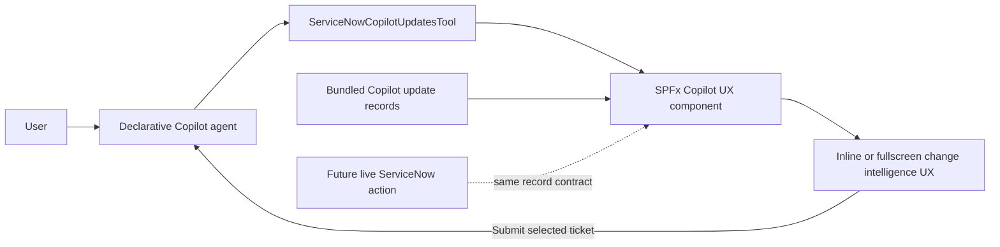
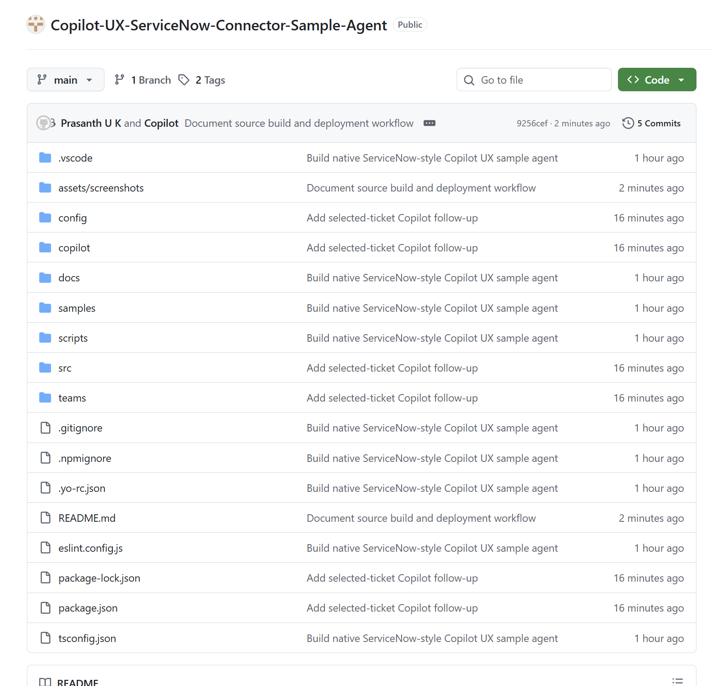
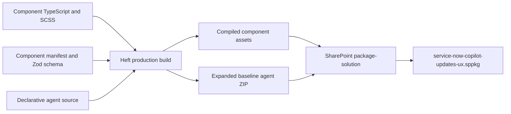
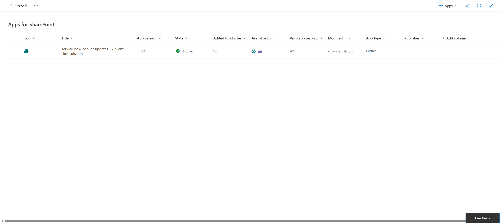

# ServiceNow Copilot Change Intelligence

Native Microsoft 365 Copilot UX component built with **SharePoint Framework 1.24.1**. It presents existing Microsoft Copilot update data as a ServiceNow-style change portfolio with metrics, filters, work-queue records, details, and inline/fullscreen display modes.

This implementation follows Microsoft’s native [Copilot UX component](https://learn.microsoft.com/sharepoint/dev/spfx/copilot/get-started/build-your-first-copilot-app) model. It does **not** require an MCP server, Azure Container Apps, or an API key.

<p align="center">
  
</p>
<p align="center"><sub>Native SPFx Copilot UX running in the tenant Copilot Workbench with filtered Copilot Studio change records.</sub></p>

### Agent screenshots

| Change portfolio | Selected change details | Fullscreen experience |
|---|---|---|
|  |  |  |

These tenant test captures show portfolio filtering, record drill-down, and inline or fullscreen rendering with the same native component.

<p align="center">
  
</p>
<p align="center"><sub>Selecting a ticket and choosing <strong>Submit ticket to Copilot</strong> publishes the record as model context and starts a ticket-specific follow-up.</sub></p>

## How to use this hands-on lab

This repository is both a working sample and a guided lab. Complete the numbered labs in order if you want to build, test, package, and deploy the solution yourself.

### Who this lab is for

- Microsoft 365 and Copilot developers learning native Copilot UX components
- SharePoint Framework developers adding a declarative agent to an SPFx solution
- Solution architects comparing native Copilot UX with Copilot Studio and MCP Apps
- Administrators validating App Catalog and tenant agent deployment

### What you will complete

By the end of the lab, you will have:

1. A local SPFx 1.24.1 Copilot Component development environment.
2. A ServiceNow-style change-intelligence UX running in Copilot Workbench.
3. A declarative agent connected to `ServiceNowCopilotUpdatesTool`.
4. A selected-ticket action that sends context back into the Copilot conversation.
5. A production `.sppkg` containing both the component and the declarative agent.
6. A tenant-wide SharePoint deployment ready for Microsoft 365 Copilot.

### Lab roadmap

| Lab | Purpose | Completion evidence |
|---|---|---|
| [Lab 0](#lab-0-understand-what-you-are-building) | Understand the scenario and architecture | You can explain the agent, tool, component, and data-provider roles |
| [Lab 1](#lab-1-prepare-your-environment) | Prepare the development tenant and workstation | Required licenses, permissions, Node.js, and npm are available |
| [Lab 2](#lab-2-get-the-code-and-understand-the-repository) | Clone the sample and understand every major folder | Dependencies install and you know which files to edit |
| [Lab 3](#lab-3-run-the-component-in-copilot-workbench) | Run the component locally | The dashboard renders from the localhost debug manifest |
| [Lab 4](#lab-4-validate-the-agent-experience) | Test filters, details, fullscreen, and ticket submission | Workbench logs model-context and follow-up bridge events |
| [Lab 5](#lab-5-understand-and-customize-the-ticket-data) | Understand and modify the record contract | Modified sample data passes schema validation |
| [Lab 6](#lab-6-build-the-component-agent-and-sharepoint-package) | Understand the source and generate production artifacts | The `.sppkg` and baseline agent ZIP are generated |
| [Lab 7](#lab-7-deploy-to-sharepoint-and-microsoft-365-copilot) | Deploy the complete solution | App Catalog shows Enabled, Valid, and Added to all sites |
| [Optional Lab A](#optional-lab-a-connect-live-servicenow-data) | Replace bundled records with connector data | Live data maps to the documented contract |
| [Optional Lab B](#optional-lab-b-adapt-the-design-for-copilot-studio) | Reuse the design in Copilot Studio | You understand which rendering layer must change |

> [!TIP]
> If you only want to evaluate the finished sample, complete Labs 1–4 and then use the ready-made package from the GitHub release. Complete Labs 5–7 when you want to modify, rebuild, or deploy your own version.

## Lab 0: understand what you are building

### Lab objective

Understand the responsibilities of the declarative agent, callable tool, SPFx component, and ServiceNow-style data contract before changing code.

### What this sample demonstrates

- SPFx `CopilotComponent` with `copilotType: "Ux"`
- Declarative Microsoft 365 Copilot agent
- Zod tool-properties schema
- ServiceNow-style connector contract
- Existing Copilot Roadmap data mapped into change records
- Inline and fullscreen rendering
- Time-window, product, rollout-status, and search filters
- Change portfolio KPIs and status distribution
- Keyboard-accessible work-queue row selection
- Detailed source, ownership, priority, status, and description view
- Selected-ticket submission back to the Copilot conversation
- Model context for ticket-specific explanations and recommended next steps
- Bundled sample data for immediate Workbench testing
- Optional `records` property for future live connector results

### Architecture and request flow



The sample intentionally separates the **UX component** from the **data provider**:

1. The declarative agent recognizes a change-intelligence request.
2. It invokes `ServiceNowCopilotUpdatesTool`.
3. The tool passes filters and optional connector records into the component.
4. The SPFx component renders the native Copilot UX.
5. When `records` is absent, bundled Copilot update data is used for testing.

See [the connector contract](./docs/connector-contract.md) for field mapping.

### Lab 0 checkpoint

Before continuing, confirm that you can identify:

- the **declarative agent** as the conversational orchestrator;
- `ServiceNowCopilotUpdatesTool` as the callable action;
- the **SPFx Copilot Component** as the rendered native UI;
- bundled JSON or a future connector as the data provider.

## Lab 1: prepare your environment

### Lab objective

Prepare a supported workstation and Microsoft 365 tenant for local development, Workbench testing, packaging, and deployment.

### Required tenant access

- Microsoft 365 tenant with a SharePoint app catalog
- Microsoft 365 Copilot license
- Permission to upload and deploy `.sppkg` solutions

### Required development tools

- Git
- SPFx 1.24.1 compatible Node.js:
  - Node 22.14 or later in the 22.x line
  - Node 24
  - Node 26
- npm
- Visual Studio Code or another editor
- Yeoman and the SharePoint Framework generator when completing the from-scratch Track B:

  ```powershell
  npm install --global yo @microsoft/generator-sharepoint
  ```

Verify:

```powershell
node --version
npm --version
```

### Expected result

- `node --version` reports a supported Node.js version.
- `npm --version` completes successfully.
- You can open the tenant SharePoint site and Copilot Workbench.
- You have permission to deploy to the SharePoint App Catalog.

## Lab 2: get the code and understand the repository

### Lab objective

Clone the working solution, install its dependencies, and understand what each repository folder contributes to the final Copilot agent package.

### Step 1: clone and install

```powershell
git clone https://github.com/ukpkumar/Copilot-UX-ServiceNow-Connector-Sample-Agent.git
Set-Location .\Copilot-UX-ServiceNow-Connector-Sample-Agent
npm install
```

### Step 2: understand the repository folders

The folders visible on the GitHub repository page are not separate applications. They are parts of one SPFx solution assembled by the Heft build.

<p align="center">
  
</p>
<p align="center"><sub>Use this repository view as the map for the folder guide below.</sub></p>

| Path | Meaning | When a lab user changes it |
|---|---|---|
| `.vscode/` | Visual Studio Code tasks and launch settings | Change only when customizing the editor/debug workflow |
| `assets/screenshots/` | Images used by this lab guide | Add screenshots when documenting new test or deployment steps |
| `config/` | SPFx, Copilot-agent linkage, serve, and package configuration | Change component mappings, package name, solution version, or build behavior |
| `copilot/` | Declarative-agent source: app manifest, agent definition, plugin, instructions, and icons | Change the agent name, prompts, instructions, actions, identity, or branding |
| `docs/` | Supporting technical documentation | Update when the connector contract or architecture changes |
| `samples/` | Ready-to-use Workbench property payloads | Change when adding tool parameters or lab test scenarios |
| `scripts/` | Repository validation utilities | Extend when adding custom validation or packaging checks |
| `src/data/` | Bundled ServiceNow-style Copilot update records | Replace or edit when changing lab data |
| `src/copilotComponents/` | TypeScript, SCSS, Zod schema, and component manifest for the native UX | This is the primary UI implementation folder |
| `teams/` | Build-generated baseline declarative-agent ZIP | Do not hand-edit; regenerate with `npm run build` |
| `sharepoint/solution/` | Build-generated `.sppkg` and diagnostic package contents | Upload the `.sppkg`; do not hand-edit generated files |
| `package.json` | Dependencies and commands such as `start`, `build`, and `validate:sample` | Change when adding dependencies or scripts |
| `package-lock.json` | Exact dependency versions | Regenerated by npm; commit it with dependency changes |
| `tsconfig.json` | TypeScript compiler configuration | Change only for deliberate compiler-setting updates |

### Step 3: open the project in your editor

```powershell
code .
```

Start with these files:

1. `src/copilotComponents/serviceNowCopilotUpdates/ServiceNowCopilotUpdatesCopilotComponent.ts`
2. `src/copilotComponents/serviceNowCopilotUpdates/ServiceNowCopilotUpdatesCopilotComponentProperties.ts`
3. `src/copilotComponents/serviceNowCopilotUpdates/ServiceNowCopilotUpdatesCopilotComponent.manifest.json`
4. `copilot/declarativeAgent.json`
5. `copilot/instruction.txt`
6. `config/copilot-agent.json`
7. `config/package-solution.json`

### Lab 2 checkpoint

Run:

```powershell
npm run validate:sample
```

Expected output:

```text
Validated 12 ServiceNow-style Copilot update records.
```

## Lab 3: run the component in Copilot Workbench

### Lab objective

Serve the component from localhost and render it inside the tenant Copilot Workbench without deploying a package.

### Step 1: start the local development server

```powershell
npm run start -- --nobrowser
```

The debug manifests are served from:

```text
https://localhost:4321
```

Expected terminal output includes:

```text
Started Webpack Dev Server at https://127.0.0.1:4321/
webpack compiled successfully
Waiting for changes.
```

Keep this terminal running for the rest of the Workbench labs.

### Step 2: open Copilot Workbench

Replace the tenant name and open the Workbench with the local debug manifest:

```text
https://<tenant>.sharepoint.com/_layouts/15/copilotworkbench.aspx?debugManifestsFile=https%3A%2F%2Flocalhost%3A4321%2Ftemp%2Fbuild%2Fmanifests.js
```

1. Select **Load debug scripts**.
2. If the browser asks whether SharePoint can access apps and services on this device, select **Allow**. This permits the Workbench to reach the localhost development server.

### Step 3: activate the component

1. Select **ServiceNowCopilotUpdates** from the component list.
2. Paste the properties from [`samples/workbench-properties.json`](./samples/workbench-properties.json).
3. Select **Fire turn**.

Example:

```json
{
  "title": "Copilot update change portfolio",
  "timeWindowDays": 30,
  "product": "Copilot Studio",
  "status": "Generally available",
  "connectorName": "ServiceNow Connector Sample"
}
```

### Step 4: confirm the initial render

Expected result:

- the header shows **Copilot update change intelligence**;
- metric cards and the work queue contain records;
- the connector badge shows **ServiceNow Connector Sample**;
- the browser console has no component compilation error.

<p align="center">
  
</p>
<p align="center"><sub>Expected Lab 3 result: the native component is rendered from the localhost debug manifest.</sub></p>

## Lab 4: validate the agent experience

### Lab objective

Exercise the interactive UX and verify that the component can send selected-ticket context into the Copilot conversation.

### Step 1: test dashboard interactions

Confirm:

- metric cards contain nonzero values;
- product, status, time-window, and search filters work;
- selecting a work-queue row opens the change details;
- **Submit ticket to Copilot** sends the selected record into the conversation;
- source, Roadmap ID, priority, state, assignment, and modified date appear;
- the Microsoft source link uses HTTP/HTTPS;
- fullscreen mode opens from the header;
- keyboard users can select rows with Enter or Space;
- light and dark host themes remain readable.

### Step 2: test the selected-ticket bridge

1. Select any ticket row, for example `CHG00579968`.
2. Confirm that the detail panel opens.
3. Select **Submit ticket to Copilot**.
4. Confirm the component displays:

   ```text
   CHG00579968 was submitted. Copilot is preparing a response in the conversation.
   ```

5. Open **View Log** in Workbench.
6. Confirm the log contains:

   ```text
   Component state update
   Follow-up message
   ```

Workbench validates the bridge operations. A deployed Microsoft 365 Copilot agent is required to validate the model-generated natural-language answer.

<p align="center">
  
</p>
<p align="center"><sub>Expected Lab 4 result: the selected ticket is published to the Copilot bridge and the component reports successful submission.</sub></p>

### Step 3: prepare the deployed-agent test prompts

Save these prompts for Lab 7, when the declarative agent is deployed:

```text
Show the Copilot update change portfolio for the last 30 days.
```

```text
Show Copilot Studio changes and highlight high-priority items.
```

```text
Show changes that are rolling out or still in development.
```

The declarative-agent instructions tell Copilot to pass period, product, and rollout status to the native UX tool.

To ask about a specific ticket, select its work-queue row and choose **Submit ticket to Copilot**. The component publishes the selected record as model context and sends a user-triggered follow-up message. Copilot then explains that ticket in the existing conversation without requiring the user to copy its number or description manually.

### Lab 4 checkpoint

- Filters and search change the displayed records.
- Row selection opens the correct ticket.
- Fullscreen mode renders correctly.
- Workbench records both model-context and follow-up bridge events.

## Lab 5: understand and customize the ticket data

### Lab objective

Understand the connector contract, safely modify the bundled data, and validate changes before rebuilding the package.

### Step 1: review the component input

The component accepts:

```typescript
{
  title?: string;
  timeWindowDays?: number;
  product?: string;
  status?: string;
  connectorName?: string;
  records?: ServiceNowUpdateRecord[];
}
```

Each record contains:

```typescript
{
  sysId: string;
  number: string;
  shortDescription: string;
  description: string;
  product: string;
  source: string;
  status: "In development" | "Rolling out" | "Generally available" | "Unknown";
  priority: "1" | "2" | "3" | "4" | "5";
  state: "Assess" | "Plan" | "Implement" | "Monitor" | "Closed";
  assignedTo: string;
  modifiedOn: string;
  sourceUrl?: string;
  roadmapId?: string;
}
```

The bundled dataset contains real Copilot update examples mapped to this contract. It is not presented as data retrieved from a live ServiceNow tenant.

### Step 2: modify a lab record

Open:

```text
src/data/copilotUpdates.sample.json
```

Change a non-identifier field such as `assignedTo` or add a new record containing every required property. Keep `sysId` and `number` unique.

### Step 3: validate the sample contract

```powershell
npm run validate:sample
```

Do not continue until validation succeeds. A schema failure identifies the record and invalid field that must be corrected.

### Lab 5 checkpoint

- Your edited data passes `npm run validate:sample`.
- The edited record appears in Workbench after the development server rebuilds.
- Filtering and ticket submission still work with the edited record.

## Optional Lab A: connect live ServiceNow data

### Lab objective

Replace bundled records with authorized live data without redesigning the Copilot UX component.

To replace bundled data:

1. Create a ServiceNow connector, API plugin, or secured intermediary API.
2. Retrieve the desired change/update records.
3. Map the response to the documented record contract.
4. Pass the resulting array to the component’s `records` property.
5. Keep authentication and secrets in the connector or API layer—not in component properties.

The component requires no redesign when the provider changes because the record contract remains stable.

## Lab 6: build the component, agent, and SharePoint package

### Lab objective

Trace how the source files are connected, then generate the production declarative-agent package and SharePoint `.sppkg`.

This section follows the same code-first model as Microsoft’s
[Build your first Copilot UX component](https://learn.microsoft.com/sharepoint/dev/spfx/copilot/get-started/build-your-first-copilot-app)
tutorial. It explains how the source becomes both a declarative agent and a deployable SharePoint `.sppkg`.

### Track A: build this completed sample

If you completed Labs 1–5, you are already in the repository and can run:

```powershell
npm run validate:sample
npm run build
```

For a standalone build without completing the earlier labs:

```powershell
git clone https://github.com/ukpkumar/Copilot-UX-ServiceNow-Connector-Sample-Agent.git
Set-Location .\Copilot-UX-ServiceNow-Connector-Sample-Agent
npm install
npm run validate:sample
npm run build
```

The finished package is written to:

```text
sharepoint/solution/service-now-copilot-updates-ux.sppkg
```

Use the following steps to understand or recreate the implementation.

### Track B: scaffold and recreate the solution

Use Track B when the learning goal is to reproduce the project from an empty folder rather than modify the completed sample.

Create a folder and run the SPFx generator:

```powershell
New-Item -ItemType Directory service-now-copilot-updates-ux
Set-Location .\service-now-copilot-updates-ux
yo @microsoft/sharepoint
```

Choose:

| Generator prompt | Value |
|---|---|
| Solution name | `service-now-copilot-updates-ux` |
| Client-side component type | **Copilot Component** |
| Component name | `ServiceNowCopilotUpdates` |
| Template | **No framework** |

The generator creates the SPFx build configuration, `src/copilotComponents/`, `copilot/`, `config/copilot-agent.json`, and the SharePoint packaging files.

### Step 1: define the tool properties with Zod

Open:

```text
src/copilotComponents/serviceNowCopilotUpdates/
  ServiceNowCopilotUpdatesCopilotComponentProperties.ts
```

Define the parameters Copilot can pass into the component:

```typescript
const propertiesSchema = z.object({
  title: z.string().optional(),
  timeWindowDays: z.number().int().positive().max(365).optional(),
  product: z.string().optional(),
  status: z.string().optional(),
  connectorName: z.string().optional(),
  records: z.array(serviceNowUpdateRecordSchema).max(100).optional()
});

export default z.toJSONSchema(propertiesSchema, { target: "draft-7" });
```

This schema becomes the input definition for `ServiceNowCopilotUpdatesTool`. The model uses the property descriptions to supply the initial period, product, status, connector name, and records.

### Step 2: implement the Copilot UX component

Open:

```text
src/copilotComponents/serviceNowCopilotUpdates/
  ServiceNowCopilotUpdatesCopilotComponent.ts
```

The component must extend `BaseCopilotComponent` and render into the host DOM:

```typescript
import {
  BaseCopilotComponent,
  createCopilotTextContent
} from "@microsoft/sp-copilot-component";

export default class ServiceNowCopilotUpdatesCopilotComponent
  extends BaseCopilotComponent<IServiceNowCopilotUpdatesCopilotComponentProperties> {

  protected render(): void {
    const isDarkTheme = this.hostContext.theme === "dark";
    const isFullscreen = this.hostContext.displayMode === "fullscreen";

    this.context.domElement.innerHTML = `<!-- component UI -->`;
    this._bindEvents();
  }
}
```

The implementation in this repository additionally:

1. Loads bundled records or accepts `records` from a future connector.
2. Applies time, product, rollout-status, and search filters.
3. Renders KPIs, the work queue, and selected-record details.
4. Calls `requestDisplayModeAsync("fullscreen")` for the expand action.
5. Publishes a selected ticket with `updateModelContextAsync`.
6. Calls `sendFollowUpMessageAsync` when the user selects **Submit ticket to Copilot**.

The ticket follow-up uses the supported bridge APIs:

```typescript
await this.context.copilotBridge.updateModelContextAsync({
  content: [createCopilotTextContent(ticketContext)],
  structuredContent: { selectedTicket: record }
});

await this.context.copilotBridge.sendFollowUpMessageAsync([
  createCopilotTextContent(`Tell me more about ticket ${record.number}.`)
]);
```

### Step 3: declare the component and its callable tool

Open:

```text
src/copilotComponents/serviceNowCopilotUpdates/
  ServiceNowCopilotUpdatesCopilotComponent.manifest.json
```

The key declarations are:

```json
{
  "componentType": "CopilotComponent",
  "copilotType": "Ux",
  "capabilities": {
    "availableDisplayModes": ["inline", "fullscreen"]
  },
  "tools": [
    {
      "name": "ServiceNowCopilotUpdatesTool",
      "propertiesSchema": {
        "id": "$../../../lib/copilotComponents/serviceNowCopilotUpdates/ServiceNowCopilotUpdatesCopilotComponentProperties.js:default;"
      }
    }
  ]
}
```

`componentType` and `copilotType` tell SPFx that this is a native Copilot UX component. The tool name is what the declarative agent invokes.

### Step 4: define the declarative agent

The `copilot/` folder is the source for the agent packaged with the component:

| File | Purpose |
|---|---|
| `manifest.json` | Microsoft 365/Teams app identity, icons, name, permissions, and declarative-agent registration |
| `declarativeAgent.json` | Agent name, description, instructions, conversation starters, and actions |
| `ai-plugin.json` | Model-facing action metadata |
| `instruction.txt` | Behavior for choosing the tool and answering ticket follow-ups |
| `color.png`, `outline.png` | Agent icons |

The declarative-agent action points to the plugin:

```json
{
  "version": "v1.8",
  "name": "ServiceNow Copilot Change Intelligence",
  "instructions": "$[file('instruction.txt')]",
  "actions": [
    {
      "id": "serviceNowCopilotUpdatesAction",
      "file": "ai-plugin.json"
    }
  ]
}
```

The instructions tell the model when to call `ServiceNowCopilotUpdatesTool`, how to map the requested filters, and how to explain a ticket submitted from the component.

### Step 5: connect the agent to the component

Open:

```text
config/copilot-agent.json
```

Add the component manifest ID to the agent:

```json
{
  "agents": [
    {
      "name": {
        "default": "ServiceNow Copilot Change Intelligence"
      },
      "components": [
        "e0a17631-57aa-4824-b1b4-d4fbe833e99a"
      ]
    }
  ]
}
```

The GUID must match the `id` in `ServiceNowCopilotUpdatesCopilotComponent.manifest.json`. This is the build-time link between the declarative agent and the native UI tool.

### Step 6: configure the SharePoint solution

Open:

```text
config/package-solution.json
```

Important values:

```json
{
  "solution": {
    "name": "service-now-copilot-updates-ux-client-side-solution",
    "version": "1.1.0.0",
    "includeClientSideAssets": true,
    "skipFeatureDeployment": true
  },
  "paths": {
    "zippedPackage": "solution/service-now-copilot-updates-ux.sppkg"
  }
}
```

`includeClientSideAssets: true` places the compiled component and agent assets inside the `.sppkg`. `skipFeatureDeployment: true` supports tenant-wide deployment when **Enable this app and add it to all sites** is selected.

### Step 7: install and validate the code

```powershell
npm install
npm run validate:sample
```

The validation script checks the bundled JSON against the same Zod record contract used at runtime.

### Step 8: test in Copilot Workbench

```powershell
npm run start -- --nobrowser
```

This runs `heft start --clean`, serves the debug manifest from `https://localhost:4321`, and watches TypeScript and SCSS. Follow the [Test in Copilot Workbench](#test-in-copilot-workbench) steps to load the component, pass tool properties, select a ticket, and test the follow-up bridge.

### Step 9: generate the declarative agent and `.sppkg`

The repository build script is:

```json
{
  "scripts": {
    "build": "heft test --clean --production && heft package-solution --production"
  }
}
```

Run:

```powershell
npm run build
```

The build performs:

| Build stage | Result |
|---|---|
| Clean, SCSS, TypeScript, lint | Validates and compiles the source |
| Production Webpack bundle | Generates optimized component JavaScript |
| Copilot agent expansion | Merges `copilot/`, `config/copilot-agent.json`, component tools, and the Zod schema |
| Agent package generation | Creates the baseline Microsoft 365 agent ZIP |
| SharePoint packaging | Embeds the agent ZIP and component assets in the `.sppkg` |



### Step 10: review the generated files

| Artifact | Purpose |
|---|---|
| `sharepoint/solution/service-now-copilot-updates-ux.sppkg` | Final package uploaded to SharePoint App Catalog |
| `teams/servicenow-copilot-change-intelligence.zip` | Intermediate baseline-agent package embedded in the `.sppkg` |
| `sharepoint/solution/debug/` | Expanded SharePoint package contents for diagnostics |
| `temp/copilot/` | Merged declarative-agent output generated by the build |

> [!IMPORTANT]
> Do not manually upload the generated `teams/*.zip` to Teams admin center. Before SharePoint synchronization, it contains the `{{TENANT_MCP_URL}}` placeholder. Upload the `.sppkg` to SharePoint and select **Add to Teams** so SharePoint supplies the tenant-specific runtime URL.

### Step 11: version and optionally publish the package

| Location | Current value | Purpose |
|---|---:|---|
| `package.json` | `0.2.0` | Source/release version |
| `config/package-solution.json` | `1.1.0.0` | Version displayed and compared by SharePoint App Catalog |
| `copilot/manifest.json` | `1.0.0` source version | Baseline Microsoft 365 app version |

For a GitHub release:

```powershell
gh release create v0.2.0 `
  .\sharepoint\solution\service-now-copilot-updates-ux.sppkg `
  --title "v0.2.0 - Selected ticket follow-up"
```

### Lab 6 checkpoint

Confirm that:

- the production build finishes without TypeScript, lint, or package-validation errors;
- `sharepoint/solution/service-now-copilot-updates-ux.sppkg` exists;
- the `.sppkg` version matches `config/package-solution.json`;
- `teams/servicenow-copilot-change-intelligence.zip` was regenerated;
- bundled data still passes `npm run validate:sample`.

## Lab 7: deploy to SharePoint and Microsoft 365 Copilot

### Lab objective

Upload the combined package, enable it tenant-wide, synchronize the declarative agent, and invoke the native UX from Microsoft 365 Copilot.

Download the ready-to-deploy package from the
[v0.2.0 release](https://github.com/ukpkumar/Copilot-UX-ServiceNow-Connector-Sample-Agent/releases/tag/v0.2.0),
or build it locally using the command above.

### Step 1: deploy through the SharePoint App Catalog

1. Open the tenant SharePoint app catalog.
2. Open **Apps for SharePoint**.
3. Upload `service-now-copilot-updates-ux.sppkg`.
4. Keep **Enable this app and add it to all sites** selected.
5. Select **Enable app**.
6. Select the uploaded application.
7. Select **Add to Teams**.

### Step 2: wait for agent-catalog propagation

**Add to Teams** deploys the baseline declarative agent to the tenant agent catalog. The Copilot UX component assets remain hosted by SharePoint.

Propagation is asynchronous. Wait several minutes before searching for the agent. If the tenant does not have an App Catalog yet, a SharePoint administrator must provision it before the package can be uploaded.

### Step 3: add the agent in Microsoft 365 Copilot

After tenant propagation:

1. Open [Microsoft 365 Copilot](https://m365.cloud.microsoft/chat).
2. Open **Agents**, then **Get agents** or **All agents**.
3. Search for **ServiceNow Copilot Change Intelligence**.
4. Select **Add**, then open the agent.
5. Try one of the prompts in the [Agent prompts](#agent-prompts) section.

The first tool invocation may request permission. Select **Allow** so the agent can render `ServiceNowCopilotUpdatesTool`.

### Step 4: validate the deployed experience

1. Submit:

   ```text
   Show the Copilot update change portfolio for the last 30 days.
   ```

2. Select a ticket in the rendered component.
3. Select **Submit ticket to Copilot**.
4. Confirm Copilot answers using the exact ticket number and supplied ticket facts.
5. Expand the component to fullscreen and confirm the layout remains usable.

### Expected deployment state

The SharePoint App Catalog row should show:

| Column | Expected value |
|---|---|
| App version | `1.1.0.0` |
| State | `Enabled` |
| Added to all sites | `Yes` |
| Valid app package | `Yes` |

### Validated lab result

The clean-install flow was validated in a Microsoft 365 test tenant on November 23, 2026:

- SharePoint accepted the package as a valid custom app.
- The solution was enabled tenant-wide and added to all sites.
- **Add to Teams** completed successfully for the initial agent deployment.
- The component rendered in Copilot Workbench in inline and fullscreen modes.
- The selected-ticket bridge published model context and emitted a follow-up message.

The latest SharePoint package, version `1.1.0.0`, contains the selected-ticket **Submit ticket to Copilot** interaction and updated agent instructions.

<p align="center">
  
</p>
<p align="center"><sub>Version 1.1.0.0 is enabled, valid, and added to all SharePoint sites.</sub></p>

Tenant agent-catalog propagation is asynchronous and can take several minutes after **Add to Teams** completes.

### Lab 7 checkpoint

- The App Catalog reports the expected deployment state.
- The agent is available in Microsoft 365 Copilot.
- A prompt invokes `ServiceNowCopilotUpdatesTool`.
- The selected-ticket action results in a contextual Copilot answer.

## Optional Lab B: adapt the design for Copilot Studio

### Lab objective

Understand which parts of this lab can be reused in Copilot Studio and which native SPFx host integration must be replaced.

**Not directly.** This repository implements a native SPFx Copilot UX component for a Microsoft 365 Copilot declarative agent. Copilot Studio cannot import the `.sppkg`, host `BaseCopilotComponent`, or invoke this Copilot Component manifest as a native Copilot Studio agent UI.

The same scenario can still be implemented in Copilot Studio by retaining the data and experience design while replacing the rendering and deployment layers:

| This native Microsoft 365 Copilot sample | Copilot Studio equivalent |
|---|---|
| SPFx `BaseCopilotComponent` | MCP App embedded UI |
| Copilot Component tool manifest | MCP server tool and UI resource |
| SharePoint `.sppkg` | Hosted MCP server |
| SharePoint App Catalog and **Add to Teams** | Copilot Studio MCP connection and agent publishing |
| Native inline/fullscreen component | Embedded MCP App, Adaptive Card, or linked Power App |

### What can be reused

- ServiceNow-style record contract and field mapping
- Copilot update sample data
- KPI, filter, search, work-queue, and detail-view behavior
- Agent prompts and change-intelligence instructions
- Live ServiceNow connector or secured API response shape

### What must be rebuilt

- The SPFx rendering class and component manifest
- The `.sppkg` packaging and SharePoint deployment flow
- Host-specific inline/fullscreen integration

For the closest Copilot Studio experience, use the
[Copilot UX Powered by MCP Apps in Copilot Studio](https://github.com/ukpkumar/Copilot-UX-Powered-by-MCP-Apps-in-Copilot-Studio)
implementation pattern. Adaptive Cards are a simpler native alternative but provide less dashboard interactivity; Power Apps can provide a rich interface but generally opens as a separate application experience.

## Architecture reference: native Copilot UX versus MCP Apps

This is a **native SPFx Copilot UX component**:

| Native Copilot UX | MCP Apps implementation |
|---|---|
| `BaseCopilotComponent` | MCP server |
| SPFx component manifest | MCP tool metadata |
| `render()` into host DOM | `ui://` HTML resource |
| Copilot Workbench | MCP Apps host harness |
| SharePoint `.sppkg` | Container deployment |
| SharePoint app catalog | Azure Container Apps |
| Microsoft 365 identity | API-key/OAuth MCP connection |

## Operational awareness: upgrades and existing tenants

This section is not part of the normal fresh-build path. It applies when an earlier version of the same app ID already exists in SharePoint or the Teams app catalog.

### Updating an existing SharePoint package

1. Increase `solution.version` in `config/package-solution.json`.
2. Run `npm run build`.
3. Upload the package using the exact original filename:

   ```text
   service-now-copilot-updates-ux.sppkg
   ```

4. Select **Replace** when SharePoint reports that the file already exists.
5. Keep **Enable this app and add it to all sites** selected.

If only component JavaScript or styling changed, redeploying the `.sppkg` is sufficient. If the agent name, icons, instructions, conversation starters, or other baseline agent configuration changed, select **Add to Teams** again.

### Existing Teams policy state

An existing app can be blocked independently in Teams admin center. During an update test—not the clean installation—the tenant returned:

```text
This app couldn't be added to Teams because it's blocked in the Teams admin center.
```

This does not invalidate or roll back the SharePoint package. A Teams administrator must unblock the existing app record and then retry **Add to Teams**.

For this sample, the Microsoft 365 app ID is:

```text
f4a0565e-9327-4609-99db-fc70f77af3b6
```

Check **Teams admin center** > **Teams apps** > **Manage apps** only when an existing-tenant update returns a policy error. A new tenant installation normally follows the standard deployment steps without this upgrade-specific cleanup.

## Appendix A: repository tree

```text
copilot/
  manifest.json
  declarativeAgent.json
  ai-plugin.json
  instruction.txt
config/
  copilot-agent.json
  package-solution.json
docs/
  connector-contract.md
samples/
  workbench-properties.json
scripts/
  validate-sample-data.mjs
src/
  data/
    copilotUpdates.sample.json
  copilotComponents/
    serviceNowCopilotUpdates/
      ServiceNowCopilotUpdatesCopilotComponent.ts
      ServiceNowCopilotUpdatesCopilotComponentProperties.ts
      ServiceNowCopilotUpdatesCopilotComponent.manifest.json
      ServiceNowCopilotUpdatesCopilotComponent.module.scss
sharepoint/solution/
  service-now-copilot-updates-ux.sppkg
teams/
  servicenow-copilot-change-intelligence.zip
```

## Appendix B: references

- [Build your first Copilot UX component](https://learn.microsoft.com/sharepoint/dev/spfx/copilot/get-started/build-your-first-copilot-app)
- [Overview of Copilot UX components](https://learn.microsoft.com/sharepoint/dev/spfx/copilot/overview-copilot-apps)
- [Provide Copilot with context from your component](https://learn.microsoft.com/sharepoint/dev/spfx/copilot/provide-context-to-copilot)
- [SPFx compatibility reference](https://learn.microsoft.com/sharepoint/dev/spfx/compatibility)
